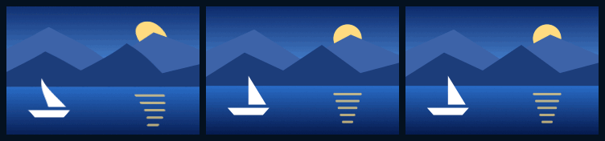
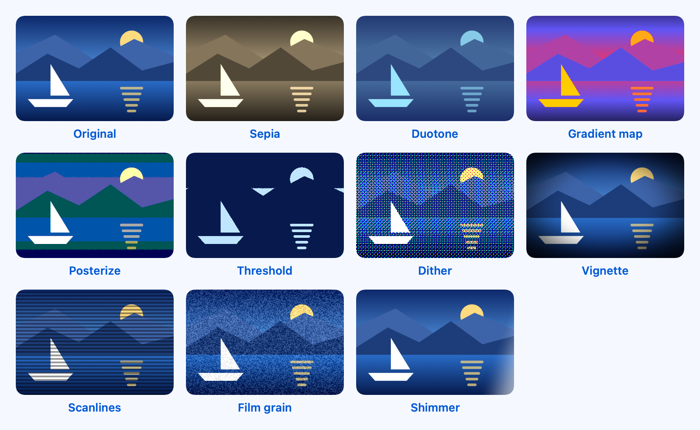
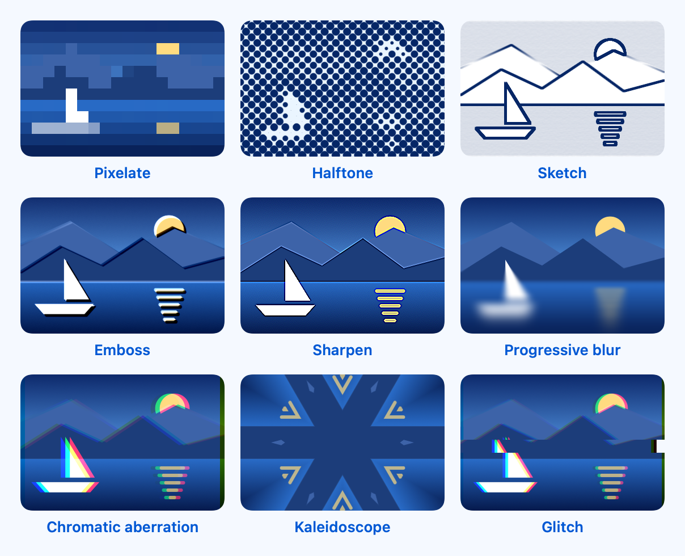
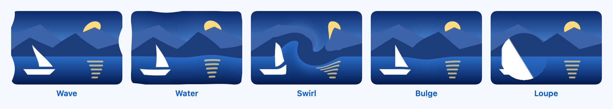
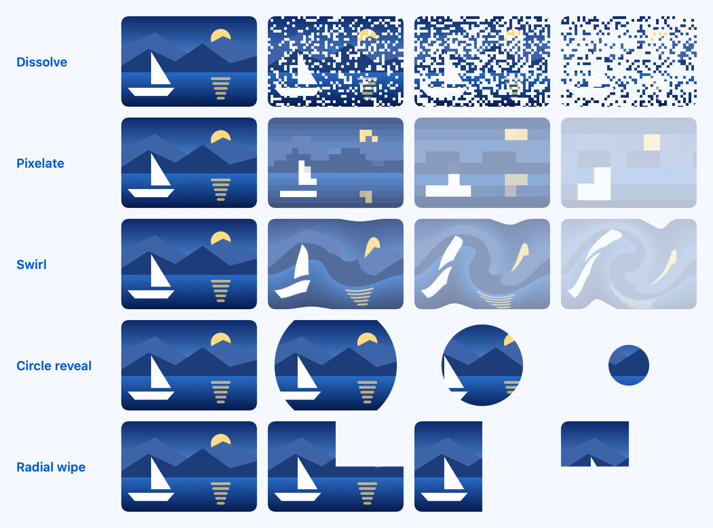
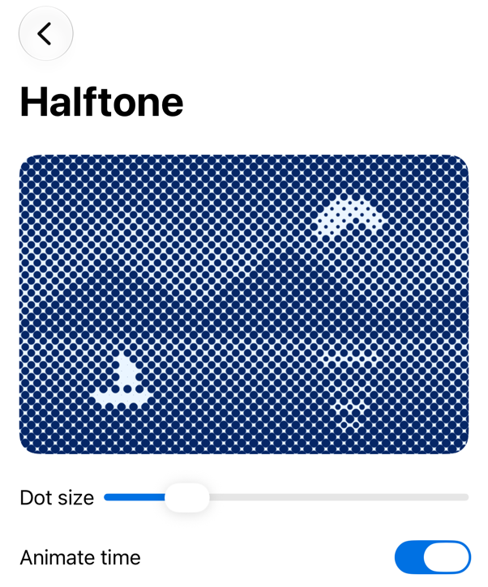
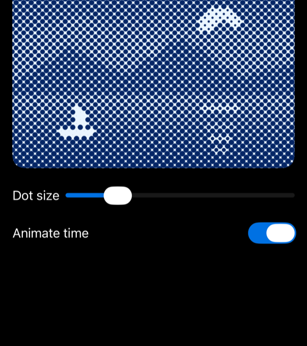

<!-- i18n-source: README.md@cd2380b7514c5fc84e4c876d40098c1bde7d6458 status=reviewed -->
<!-- brand:start -->

<p align="center"><picture><source media="(prefers-color-scheme: dark)" srcset="https://raw.githubusercontent.com/muhittincamdali/SwiftShaders/main/.github/brand/banner-ru-dark.svg"><source media="(prefers-color-scheme: light)" srcset="https://raw.githubusercontent.com/muhittincamdali/SwiftShaders/main/.github/brand/banner-ru-light.svg"></picture></p>

<!-- lang-selector:start -->
<p align="center"><a href="README.md">English</a> · <a href="README.tr.md">Türkçe</a> · <a href="README.zh-CN.md">简体中文</a> · <a href="README.ja.md">日本語</a> · <a href="README.ko.md">한국어</a> · <a href="README.es.md">Español</a> · <a href="README.de.md">Deutsch</a> · <a href="README.fr.md">Français</a> · <a href="README.pt-BR.md">Português (Brasil)</a> · <a href="README.ru.md">Русский</a></p>
<!-- lang-selector:end -->

<p align="center">
<a href="https://github.com/muhittincamdali/SwiftShaders/actions/workflows/ci.yml"></a>
<a href="https://github.com/muhittincamdali/SwiftShaders/releases"><picture><source media="(prefers-color-scheme: dark)" srcset="https://raw.githubusercontent.com/muhittincamdali/SwiftShaders/main/.github/brand/badge-version-dark.svg"><source media="(prefers-color-scheme: light)" srcset="https://raw.githubusercontent.com/muhittincamdali/SwiftShaders/main/.github/brand/badge-version-light.svg"></picture></a>
<a href="https://github.com/muhittincamdali/SwiftShaders/blob/main/Package.swift"><picture><source media="(prefers-color-scheme: dark)" srcset="https://raw.githubusercontent.com/muhittincamdali/SwiftShaders/main/.github/brand/badge-platforms-dark.svg"><source media="(prefers-color-scheme: light)" srcset="https://raw.githubusercontent.com/muhittincamdali/SwiftShaders/main/.github/brand/badge-platforms-light.svg"></picture></a>
<a href="https://github.com/muhittincamdali/SwiftShaders/blob/main/Package.swift"><picture><source media="(prefers-color-scheme: dark)" srcset="https://raw.githubusercontent.com/muhittincamdali/SwiftShaders/main/.github/brand/badge-language-dark.svg"><source media="(prefers-color-scheme: light)" srcset="https://raw.githubusercontent.com/muhittincamdali/SwiftShaders/main/.github/brand/badge-language-light.svg"></picture></a>
<a href="https://github.com/muhittincamdali/SwiftShaders/blob/main/LICENSE"><picture><source media="(prefers-color-scheme: dark)" srcset="https://raw.githubusercontent.com/muhittincamdali/SwiftShaders/main/.github/brand/badge-license-dark.svg"><source media="(prefers-color-scheme: light)" srcset="https://raw.githubusercontent.com/muhittincamdali/SwiftShaders/main/.github/brand/badge-license-light.svg"></picture></a>
</p>

<p align="center">
<a href="#быстрый-старт"><picture><source media="(prefers-color-scheme: dark)" srcset="https://raw.githubusercontent.com/muhittincamdali/SwiftShaders/main/.github/brand/button-start-ru-dark.svg"><source media="(prefers-color-scheme: light)" srcset="https://raw.githubusercontent.com/muhittincamdali/SwiftShaders/main/.github/brand/button-start-ru-light.svg"></picture></a>
<a href="https://muhittincamdali.github.io/SwiftShaders/documentation/swiftshaders/"><picture><source media="(prefers-color-scheme: dark)" srcset="https://raw.githubusercontent.com/muhittincamdali/SwiftShaders/main/.github/brand/button-docs-ru-dark.svg"><source media="(prefers-color-scheme: light)" srcset="https://raw.githubusercontent.com/muhittincamdali/SwiftShaders/main/.github/brand/button-docs-ru-light.svg"></picture></a>
<a href="https://github.com/muhittincamdali/SwiftShaders/tree/main/Examples"><picture><source media="(prefers-color-scheme: dark)" srcset="https://raw.githubusercontent.com/muhittincamdali/SwiftShaders/main/.github/brand/button-examples-ru-dark.svg"><source media="(prefers-color-scheme: light)" srcset="https://raw.githubusercontent.com/muhittincamdali/SwiftShaders/main/.github/brand/button-examples-ru-light.svg"></picture></a>
</p>

> Это перевод README на английском языке. Если они расходятся, актуальна английская версия.

<!-- brand:end -->

Swift-пакет с GPU-эффектами для SwiftUI на iOS 17+ и macOS 14+: цветовые эффекты вроде sepia, duotone и halftone, прогрессивное размытие, искажения вроде wave, swirl и loupe, волны, которые идут от касаний, заливки шейдерами и переходы между представлениями. Каждый эффект — это один view modifier поверх собственных `colorEffect`, `distortionEffect` и `layerEffect` из SwiftUI, поэтому он работает с любым представлением: изображением, текстом, фигурой или целым экраном. Пакет предназначен для разработчиков приложений, которым нужны такие эффекты без написания кода на Metal; а тем, кто хочет писать на Metal, каждая функция шейдера описана в документации, и её можно вызывать напрямую. У пакета нет зависимостей.

<p align="center"></p>

## Основные возможности

- **26 view modifier'ов, 3 заливки и 5 переходов** — посчитаны по исходному коду и перечислены в таблице ниже; для каждого описаны параметры и диапазоны их значений.
- **Аргументы, которые не могут сломать шейдер** — значения ограничиваются своими диапазонами, NaN отключает эффект, углы, позиции и время удерживаются в пределах значений, которые вмещает 32-битный float, и ни один аргумент не заставит SwiftUI выделить offscreen-слой больше, чем представление вместе с его диагональю.
- **Чистые края** — эффекты, сравнивающие соседние пиксели, читают только внутри представления, поэтому у представления с повышенной резкостью, рельефом или эффектом наброска нет тёмной или светлой каймы, а цветовые эффекты сохраняют сглаженный альфа-канал текста и символов.
- **Уменьшение движения (Reduce Motion)** — когда этот параметр включён, анимированные эффекты останавливаются на первом кадре, а волны игнорируют касания.
- **Проверка на уровне пикселей** — 76 тестов Swift Testing отрисовывают эффекты через `ImageRenderer` и сравнивают пиксели со значениями, вычисленными в Swift, на macOS и в симуляторе iPhone. Ещё один тест загружает скомпилированную библиотеку Metal и проверяет, что в ней ровно те функции, которые вызывает код на Swift.
- **Примеры, которые компилируются** — каждый пример ниже взят из [демонстрационного приложения](Examples/ShaderGallery), которое CI собирает для iOS и macOS; тесты отрисовывают каждый из них.

### Что входит в пакет

| Вид           | Эффекты                                                                                                                   |
| ------------- | ------------------------------------------------------------------------------------------------------------------------- |
| Цвет (10)     | `sepia`, `duotone`, `gradientMap`, `posterize`, `threshold`, `dither`, `vignette`, `scanlines`, `filmGrain`, `shimmer`    |
| Слой (9)      | `pixelate`, `halftone`, `sketch`, `emboss`, `sharpen`, `progressiveBlur`, `chromaticAberration`, `kaleidoscope`, `glitch` |
| Искажение (5) | `wave`, `water`, `swirl`, `bulge`, `loupe`                                                                                |
| Волны (2)     | `rippleOnTap`, `ripple(origin:elapsedTime:style:)`                                                                        |
| Заливки (3)   | `.checkerboard`, `.stripes`, `.plasma` для любого `ShapeStyle`                                                            |
| Переходы (5)  | `.dissolve`, `.pixelate`, `.swirl`, `.circleReveal`, `.radialWipe`                                                        |

Анимированные эффекты принимают `ShaderTime`: `.animated`, `.animated(speed:)` или `.fixed(_:)` для одного кадра.

## Быстрый старт

**1. Добавьте пакет**

В Xcode выберите **File › Add Package Dependencies…** и введите URL репозитория:

```text
https://github.com/muhittincamdali/SwiftShaders.git
```

Вставьте его в поле поиска в правом верхнем углу окна. Оставьте **Dependency Rule** в положении **Up to Next Major Version** начиная с `2.0.0` и нажмите **Add Package**. В следующем окне выберите таргет вашего приложения рядом с **SwiftShaders** и ещё раз нажмите **Add Package**.

**2. Импортируйте модуль**

```swift
import SwiftShaders
```

Поместите эту строку в начало Swift-файла, где вы используете эффект, под `import SwiftUI`.

**3. Используйте**

В новом приложении Xcode (**File › New › Project… › App**) замените всё содержимое `ContentView.swift` на:

```swift
import SwiftShaders
import SwiftUI

struct ContentView: View {
    var body: some View {
        Image(systemName: "mountain.2.fill")
            .font(.system(size: 96))
            .foregroundStyle(.blue)
            .padding(40)
            .background(.blue.opacity(0.15), in: .rect(cornerRadius: 24))
            .halftone(dotSize: 6, ink: .blue, paper: .white)
    }
}
```

Нажмите **Run** (⌘R). Горы появятся в виде растровой печати halftone: синие точки на белой бумаге, крупные там, где символ, и мелкие вокруг него. Измените `dotSize` на 10 и запустите снова, чтобы увидеть более крупные точки.

## Установка

### Swift Package Manager

В Xcode выберите **File › Add Package Dependencies…** и введите URL репозитория:

```text
https://github.com/muhittincamdali/SwiftShaders.git
```

Или добавьте его в `dependencies` вашего `Package.swift`:

```swift
dependencies: [
    .package(url: "https://github.com/muhittincamdali/SwiftShaders.git", from: "2.0.0")
],
targets: [
    .target(name: "YourApp", dependencies: [
        .product(name: "SwiftShaders", package: "SwiftShaders")
    ])
]
```

Эффекты — это файлы `.metal`, которые компилируются в бандл пакета. Xcode компилирует их всегда, а `swift build` — начиная с Swift 6.4, где движок Swift Build из SwiftPM используется по умолчанию. Более старый `swift build` копирует файлы без компиляции, и представления с эффектом не отрисовываются; `SwiftShaders.isMetalLibraryAvailable` подскажет, какой у вас случай.

Версия 2.0.0 (октябрь 2026) — это новый пакет с новым API. Предыдущий релиз, 1.0.0 (февраль 2026), не собирался текущим компилятором Metal и искал шейдеры в бандле приложения, а не пакета, поэтому его эффекты так и не появились. В июне 2026 года его код заменили заглушками, а в октябре 2026 года пакет написали заново с нуля. Что изменилось, перечислено в [CHANGELOG.md](CHANGELOG.md).

## Использование

Примеры ниже скопированы из
[`Examples/ShaderGallery/ShaderGallery/ReadmeSamples.swift`](Examples/ShaderGallery/ShaderGallery/ReadmeSamples.swift).
Демонстрационное приложение и набор тестов компилируют этот файл.

### Комбинируйте эффекты

Эффекты применяются по порядку, от представления наружу:

```swift
struct RetroScreenSample: View {
    var body: some View {
        Text("GAME OVER")
            .font(.system(size: 44, weight: .black, design: .monospaced))
            .foregroundStyle(.cyan)
            .padding(32)
            .background(Color(red: 0.02, green: 0.07, blue: 0.2))
            .chromaticAberration(offset: 2)
            .scanlines(spacing: 3, intensity: 0.4)
            .vignette(intensity: 0.7)
    }
}
```

### Покажите, что содержимое загружается

`shimmer` осветляет только то, что нарисовано, поэтому фигуры-заглушки мерцают, а пространство вокруг них остаётся пустым. Если включён Reduce Motion, полоса не показывается.

```swift
struct LoadingRowSample: View {
    var body: some View {
        HStack(spacing: 12) {
            Circle()
                .frame(width: 44, height: 44)
            VStack(alignment: .leading, spacing: 8) {
                Capsule().frame(width: 160, height: 12)
                Capsule().frame(width: 100, height: 12)
            }
        }
        .foregroundStyle(.gray.opacity(0.3))
        .shimmer()
    }
}
```

### Анимация во времени

Анимированные эффекты работают сами. Передайте `time: .fixed(seconds)`, чтобы показать один кадр, например в превью и snapshot-тестах, или чтобы управлять временем из собственной анимации.

```swift
struct WavingFlagSample: View {
    var body: some View {
        Rectangle()
            .fill(.stripes(width: 18, angle: .zero, .blue, .white))
            .frame(width: 240, height: 150)
            .wave(amplitude: 5, wavelength: 120, speed: 0.8)
    }
}
```

### Волна там, где коснулся пользователь

Касание распознаётся наряду с собственными жестами представления, поэтому кнопки внутри него продолжают работать.

```swift
struct RippleCardSample: View {
    var body: some View {
        RoundedRectangle(cornerRadius: 24)
            .fill(.blue.gradient)
            .overlay {
                Text("Tap me")
                    .font(.title.bold())
                    .foregroundStyle(.white)
            }
            .frame(width: 280, height: 180)
            .rippleOnTap()
    }
}
```

### Переход между представлениями

```swift
struct DissolveTransitionSample: View {
    @State private var isShown = true

    var body: some View {
        VStack(spacing: 24) {
            if isShown {
                Image(systemName: "sparkles")
                    .font(.system(size: 80))
                    .foregroundStyle(.blue)
                    .transition(.dissolve)
            }
            Button(isShown ? "Hide" : "Show") {
                withAnimation(.easeInOut(duration: 1)) { isShown.toggle() }
            }
        }
        .frame(height: 160)
    }
}
```

### Вызов шейдера напрямую

`ShaderLibrary.swiftShaders` — это скомпилированная библиотека для собственных модификаторов эффектов SwiftUI или для заливок. [Список аргументов каждой функции](https://muhittincamdali.github.io/SwiftShaders/documentation/swiftshaders/howeffectsaredrawn) есть в документации; при таких вызовах проверки аргументов пакета не выполняются.

```swift
struct DirectShaderSample: View {
    var body: some View {
        RoundedRectangle(cornerRadius: 16)
            .fill(ShaderLibrary.swiftShaders.ssCheckerboard(.float(10), .color(.white), .color(.blue.opacity(0.3))))
            .frame(width: 200, height: 120)
    }
}
```

## Демо

Каждый эффект, применённый к пейзажу, нарисованному кодом. Изображения отрисованы скриптом
[`scripts/generate-screenshots.sh`](scripts/generate-screenshots.sh) из
[`Tests/SwiftShadersTests/Screenshots.swift`](Tests/SwiftShadersTests/Screenshots.swift):

<picture><source media="(prefers-color-scheme: dark)" srcset="docs/images/effects-color-dark.png"></picture>

<picture><source media="(prefers-color-scheme: dark)" srcset="docs/images/effects-layer-dark.png"></picture>

<picture><source media="(prefers-color-scheme: dark)" srcset="docs/images/effects-distortion-dark.png"></picture>

Переходы на 0, 25, 50 и 75 процентах пути:

<picture><source media="(prefers-color-scheme: dark)" srcset="docs/images/transitions-dark.png"></picture>

Halftone в демонстрационном приложении на симуляторе iPhone, снимок сделан скриптом [`scripts/capture-gallery.sh`](scripts/capture-gallery.sh):

| Светлая тема                                                                                                          | Тёмная тема                                                                                                         |
| --------------------------------------------------------------------------------------------------------------------- | ------------------------------------------------------------------------------------------------------------------- |
|  |  |

Чтобы попробовать эффекты самостоятельно, откройте `ShaderGallery.xcodeproj` из [`Examples/ShaderGallery`](Examples/ShaderGallery) в Xcode, выберите симулятор iPhone или **My Mac** и нажмите **Run**. У каждого эффекта есть ползунок для его главного параметра; подробности — в [Examples/README.md](Examples/README.md).

## Документация

Справочная документация и статьи:

- [Справочник по API](https://muhittincamdali.github.io/SwiftShaders/documentation/swiftshaders/)
  (DocC, публикуется на GitHub Pages из ветки `main`)
- Локально её можно собрать в Xcode командой **Product › Build Documentation** или из командной строки:

```sh
xcodebuild docbuild -scheme SwiftShaders -destination 'generic/platform=macOS'
```

## Руководства

- [Getting Started](https://muhittincamdali.github.io/SwiftShaders/documentation/swiftshaders/gettingstarted)
  — добавление пакета, применение и комбинирование эффектов, проверка инструмента сборки, Reduce Motion
  ([исходник](Sources/SwiftShaders/SwiftShaders.docc/GettingStarted.md)).
- [Animating Effects](https://muhittincamdali.github.io/SwiftShaders/documentation/swiftshaders/animatingeffects)
  — анимированное, фиксированное и управляемое вами время, волны и причина, по которой время начинается заново каждый час
  ([исходник](Sources/SwiftShaders/SwiftShaders.docc/AnimatingEffects.md)).
- [How Effects Are Drawn](https://muhittincamdali.github.io/SwiftShaders/documentation/swiftshaders/howeffectsaredrawn)
  — цветовые эффекты, искажения и эффекты слоя, как проверяются аргументы, и список аргументов
  каждой функции шейдера ([исходник](Sources/SwiftShaders/SwiftShaders.docc/HowEffectsAreDrawn.md)).

## Требования

| Платформа | Минимальная версия    |
| --------- | --------------------- |
| iOS       | 17                    |
| macOS     | 14                    |
| Toolchain | Swift 6.2 · Xcode 26+ |

Чтобы `swift build` и `swift test` в командной строке скомпилировали шейдеры, нужен Swift 6.4 (см. [Установка](#установка)); Xcode 26 и новее компилирует их в любом случае. CI собирает проект в Xcode по умолчанию из образа раннера `macos-26` на GitHub. Пакет разрабатывается в Xcode 27.

## Архитектура

- `Sources/SwiftShaders/Shaders/` содержит код на Metal — по одному файлу на каждый вид эффекта, а вспомогательные функции лежат в `ShaderCommon.h`. Каждая функция помечена `[[ stitchable ]]` и начинается с `ss`, поэтому не может конфликтовать с шейдерами приложения.
- `Sources/SwiftShaders/Effects/`, `Fills/` и `Transitions/` содержат Swift API: на каждый шейдер приходится один view modifier, заливка или переход — по несколько строк, которые проверяют аргументы и вызывают шейдер.
- `Core/ShaderEffect.swift` применяет шейдер: измеряет представление через `visualEffect`, запускает `TimelineView` для анимированных эффектов (при Reduce Motion он останавливается) и помещает эффекты слоя в compositing group. `Core/ShaderInput.swift` содержит все проверки аргументов, а `Core/ShaderTime.swift` — анимированное и фиксированное время, которое начинается заново каждый час.
- Тесты отрисовывают представления через `ImageRenderer` поверх чёрного и поверх белого, что даёт цвет и альфа-канал каждого пикселя, и сравнивают их со значениями, вычисленными в Swift. `InputSafetyTests` передаёт NaN, бесконечности и огромные значения в эффекты каждого вида, а `LibraryTests` сравнивает имена функций скомпилированной библиотеки с именами, которые вызывает код на Swift.
- CI запускает тесты на macOS и в симуляторе iPhone через `xcodebuild`, собирает демонстрационное приложение для iOS и macOS и публикует документацию DocC.

Запустить тесты локально:

```sh
swift test                                    # macOS, Swift 6.4 or later
xcodebuild test -scheme SwiftShaders \
  -destination 'platform=iOS Simulator,name=iPhone 17'
```

## План развития

- Добавить пакет в Swift Package Index; `.spi.yml` уже есть в репозитории.
- Протестировать и включить tvOS и visionOS, где в SwiftUI тот же API шейдеров.
- Вариант прогрессивного размытия с маской, повторяющей любую фигуру.

## Участие в разработке

Мы рады вашему участию. Перед тем как открыть pull request, прочитайте [руководство для контрибьюторов](https://github.com/muhittincamdali/SwiftShaders/blob/main/CONTRIBUTING.md) и [кодекс поведения](https://github.com/muhittincamdali/.github/blob/main/CODE_OF_CONDUCT.md). Об уязвимостях сообщайте конфиденциально, как описано в [политике безопасности](https://github.com/muhittincamdali/.github/blob/main/SECURITY.md).

## Лицензия

Распространяется по лицензии MIT. См. [LICENSE](LICENSE).
